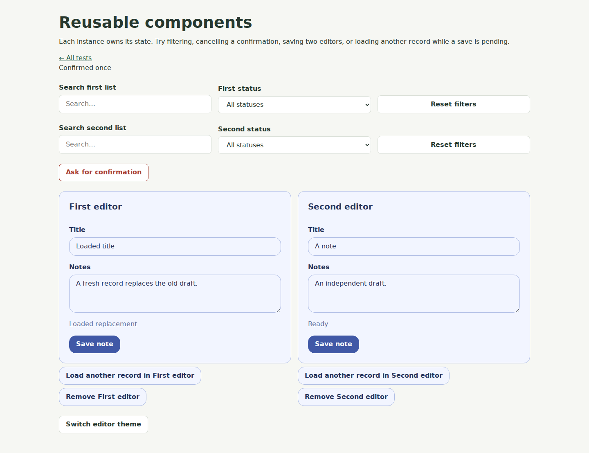

# Reusable components and themes

A component is an ordinary C++ class derived from `tatzel::ui::Component`. It owns
local application state and a logical subtree of existing controls. Create it
with `PageBuilder::Component<T>(args...)`; the builder supplies identity/parent
constructor arguments, attaches the component, then invokes its `Build` method.
Components use the current adapter, field revisions, update batches, forms,
checked handles, and dispatcher. They require no browser component framework or
additional wire operations.



## Defining a component

```cpp
class Greeting : public tatzel::ui::Component
{
public:
    Greeting(
        std::string_view id,
        tatzel::ui::LogicalElement* parent,
        std::string name
    ) :
        Component{ id, parent },
        name{ std::move( name ) }
    {}

    template<typename BuilderT>
    auto Build( BuilderT ui ) -> void
    {
        message = ui.Text( "Hello, " + name )->GetHandle();
    }

    auto Rename( std::string name ) -> void
    {
        this->name = std::move( name );
        if( auto* text = message.Get() ) text->SetText( "Hello, " + this->name );
    }

private:
    std::string name;
    tatzel::ui::ElementHandle<tatzel::ui::Text> message;
};

auto* greeting = ui.Component<Greeting>( "Niko" );
greeting->Rename( "World" );
```

This shortened example omits Doxygen contracts; production declarations follow
[the coding conventions](../CODING_CONVENTIONS.md). Include the standard headers
you use and import UI. Build is a template so a class does not instantiate a
constrained PageBuilder of its own incomplete type inside its declaration.
The factory supplies PageBuilder<Greeting>; Build can use its normal child
builders and GetDispatcher. Build must run once, through the component factory.
Constructors store owned configuration; create children in Build after adapter
mapping and attachment. Callbacks receive owned snapshots when data must outlive
an invocation. Free builder functions remain suitable for stateless composition.

## Ownership and failure

The parent owns the component, which owns its logical children at stable
addresses. Removing it invalidates every subtree handle immediately, including
handles to hidden dialogs. Removed objects are released after the enclosing
dispatch scope. Disposal does not invoke application confirmation/close outcomes.
Callers receive nullptr when initialization or Build removes the component.

The component factory opens an update scope outside its removal scope. If Build
throws, it removes the newly attached partial subtree before rethrowing. Queued
creation/initialization precedes its cleanup removal. Existing siblings remain
active and a caller can catch the exception and continue. This cleans up the new
component; it does not undo mutations Build made to external objects. Constructor
failures attach no component. Failures during post-attachment adapter initialization
also remove the newly attached control before propagation. Applications should
avoid unrelated mutations and external subscriptions while constructing a component.

A component method runs only on its owning UI loop. Workers receive owned input
and a Dispatcher; completions resolve an ElementHandle<ComponentType> inside Post.
Callback code may remove its component. A method that continues after application
callbacks needs a removal scope and must check lifetime before touching controls.
The reusable examples copy callbacks and establish diagnostic/removal boundaries.

## SearchFilterBar

`UI.Component.SearchFilterBar` exports SearchFilterBar, SearchFilterOptions,
FilterDefinition, and FilterValues. UI re-exports them.

```cpp
auto options = tatzel::ui::SearchFilterOptions{
    .search_label = "Search tasks",
    .filters = {
        { "status", "Status", { { "all", "All" }, { "open", "Open" } }, "all", "all" }
    }
};
auto* filters = ui.Component<tatzel::ui::SearchFilterBar>( std::move( options ) );
filters->SetOnChange( []( tatzel::ui::FilterValues values ) {
    // values owns its query and ordered application key/value selections.
} );
```

Keys must be unique and nonempty. Initial/reset values must be enabled choices
or empty. A browser search/selection edit reports one coherent copied snapshot.
Reset clears search, applies each configured reset value with Replace, then
reports one snapshot. Empty reset_label omits the built-in reset button.

SetChoices(key, choices, fallback) updates one selector in place, preserves an
available selection, and uses fallback when it disappears. The configured reset
value must remain available. The fallback travels in the same choices operation,
so it does not override a newer available browser selection with a second reset.
Invalid definitions leave the existing selector
unchanged. Programmatic refreshes do not invoke the application callback. The
wire revision contract can still preserve and rebase a newer available browser
selection, which subsequently reports a normal change. GetValues reads current
logical values; it does not wait for browser edits still in transit.

Workspace uses this component for task search, project/status filtering, and
sorting. It retains the search editor during external updates. Clear filters
also resets sorting to its configured default.

## ConfirmationDialog

`UI.Component.ConfirmationDialog` exports ConfirmationDialog and ConfirmationOptions.
Construct it with title/message/button wording and a ButtonVariant for acceptance.
Request(callback) opens a built dialog; callback receives true for Confirm and
false for Cancel, Escape, backdrop, close button, or native dismissal. A second
request while one is pending throws tatzel::Exception. An empty callback or an
inactive dialog also throws.

The pending callback is consumed and the native modal closes before application
code runs. Repeated dismissal/activation cannot deliver the same outcome twice.
The callback may remove the component or start another request. Cancel is a
no-op when idle. Removal discards a pending callback silently, releasing its
captures. Native dialog behavior provides keyboard focus containment and restores
surviving opener focus on closure. Each instance has independent request state.

Workspace uses the same component for delete and sample-reset confirmations.
The application starts persistence only after acceptance; persistence failures
are reported by the application's existing feedback path.

## Application editors and asynchronous results

The /components page instantiates example::NoteEditor twice. Its source is
[NoteEditor.hpp](../targets/development/private/NoteEditor.hpp). Each owns its
form, fields, feedback, draft, busy state, and private request generation.
Valid submission passes an owned NoteDraft and NoteSaveToken to SetOnSave.
The example service returns through the dispatcher after 300 ms. Title `fail`
demonstrates a failed save that preserves the draft.

Load(record) intentionally replaces fields, clears busy state, and supersedes
older completion tokens. CompleteSave checks component identity and request
generation, accepts only the pending request once, and preserves loaded state
when a stale completion arrives. Removal makes the completion's handle empty.
A synchronous save-start exception restores interaction for the same request
and propagates through the ordinary page error boundary. Loading another record
or removing the editor from inside the callback cannot make the old failure
handler overwrite the new state. This generation is local application state;
individual asynchronous field corrections use GetEditRevision/TrySetValue.

Workspace's TaskEditor is application code in
[TaskEditor.hpp](../targets/workspace/private/TaskEditor.hpp). It emits owned Task
records with optimistic versions; Workspace retains persistence/navigation and
page-level busy handling. Its checked form accessor integrates with that existing
page coordination. These application editors are examples, not generic persistence
or data-binding facilities.

## Styling contract

Load framework/layout.css and framework/components.css before application CSS.
The default template uses these local assets without a CDN dependency. Workspace
loads the same foundation and overrides its application presentation.

| Concern | Logical API or theme mechanism |
| --- | --- |
| Application-specific purpose | LogicalElement::SetAppearance with adapter-defined names. |
| Button emphasis | Button::SetVariant: Primary, Secondary, Danger. |
| Control dimensions | `Button::SetSize` and `FormField::SetSize`: Small, Medium, Large. |
| Disabled button | Button::SetDisabled, enforced by native state and server invocation. |
| Dynamic feedback | `Text::SetLiveRegion` (also inherited by Paragraph): Off, Polite, Assertive. |
| Spacing and wrapping | Existing Row/Column/Layout options, using shared spacing variables. |
| Theme | Inherited --tatzel-* CSS variables, overridden globally or on a component ancestor. |

A component can pass a stable name as the third Component base-constructor
argument. Its immutable GetComponentName maps to data-ui-component; built-in
component layout uses this identity, so SetAppearance cannot remove essential
component styling. Application-specific appearances remain independent.

Variant/size changes preserve appearance, field revisions, native values, and
editor identity. The default adapter reflects them as data-ui-variant/data-ui-size.
Those attributes are adapter details; application C++ uses logical methods.
Live text maps to aria-live and aria-atomic. Existing field labels, descriptions,
validation errors, native keyboard behavior, and required/read-only states remain
owned by the controls and adapter.

Supported tokens are --tatzel-font, --tatzel-accent, --tatzel-accent-text,
--tatzel-text, --tatzel-muted, --tatzel-surface, --tatzel-border, --tatzel-danger,
--tatzel-focus, --tatzel-radius, and --tatzel-space-small/medium/large. The demo's
Switch editor theme overrides these variables on the editor group, leaving its
existing controls and drafts in place. Component/application appearances remain
scoped by token selectors rather than DOM IDs. CSS handles filter/editor wrapping
without server resize events.

Applications can ship component styles in ordinary local stylesheets. There is
no automatic CSS bundler, selector rewriting, per-component shadow DOM, reactive
binding system, or arbitrary slot registry. A new primitive still needs an adapter
mapping; composition of supported controls uses existing mappings. Browser-side
component code and a protocol-version change are unnecessary for this milestone.

## Verification

TatzelComponentTests uses the actual builder, default adapter, logical tree, and
frame sink to check partial construction cleanup, removal, independent state,
confirmation reentrancy/disposal, style state, and asynchronous editor generations.
Run tests/browser/components-ui.mjs against TatzelDevelopment for the desktop/mobile
journey, theme changes, focus restoration, validation, save results, and removal
during work. Screenshots are written to build/components-preview and uploaded by
CI. The existing Workspace journey also exercises the refactored real application.
