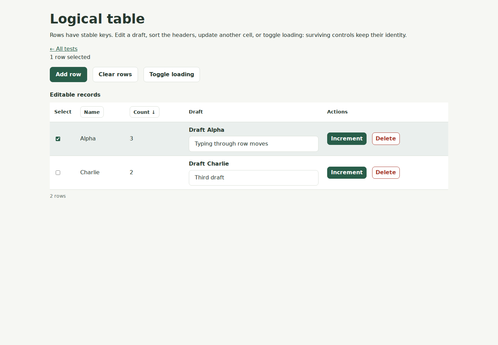

# Tables and stable rows

Table owns semantic columns and row subtrees. Application records, sorting,
queries, and persistence stay in application code. The default adapter renders
native table, caption, headers, and cells, with normal Button and Checkbox
controls for sorting and selection. It keeps native tab order and keyboard
activation rather than implementing a spreadsheet keyboard model.

Run TatzelDevelopment and open http://localhost:8080/tables to try editable cells,
sorting, selection, increment/delete actions, loading, and empty states. Workspace
uses the same control for its persisted task list.



## Build a table

```cpp
auto* table = ui.Table( "Tasks", {
    { "title", "Task", true },
    { "status", "Status" },
    { "actions", "Actions" }
}, tatzel::ui::TableSelection::Single );
auto rows = ui.Scope( *table );
rows.TableRow( "task:42", []( auto cells ) {
    cells.TableCell( "title", "Write the guide" );
    cells.TableCell( "status", "In progress" );
    cells.TableCell( "actions", []( auto content ) {
        content.Link( "Open", "#/tasks/42" );
    } );
}, "Write the guide" );
```

Caption and column keys must be nonempty. Column keys must be unique and cannot
use the reserved __selection key. Columns and selection mode are fixed for the
table lifetime. TableRow requires a unique nonempty application key. All schema
cells are created in schema order before the row callback; omitted cells stay
empty. TableCell accepts a plain string or a builder for normal logical controls.
The optional row label supplies accessible selection wording, such as
“Select Write the guide”; the key is used when no label is provided.

Keys are owned application strings, separate from generated logical and DOM
identities. Two tables may use the same keys. Removing and recreating a key
creates a fresh row/control identity: late events for the removed controls
cannot operate on its replacement.

## Reconcile records without rebuilding

Keep the Table handle and a scoped row builder on the owning UI loop. When an
application snapshot changes:

1. Remove missing records with RemoveRow(key).
2. Find surviving rows with FindRow(key), and update changed cells or their
   existing child controls. TableCell::SetText intentionally clears that cell's
   controls; update a child TextInput or Link directly when it should survive.
3. Create only new records with TableRow.
4. Call SetRowOrder with every active key exactly once, in the desired order.

SetRowOrder validates complete membership before changing state. It moves
existing browser rows without recreating cells, field revisions, or event
sources. Missing, duplicate, and foreign keys throw tatzel::Exception. Unchanged
order queues no move. Text cells also avoid updates for unchanged text.

RemoveRow invalidates the row and all cell/control handles immediately.
ClearRows retains the table, headers, caption, and callbacks. Direct row Remove
or a full logical subtree removal follows the same ownership rules. Use checked
handles in stored callbacks, as with other logical controls; borrowed pointers
returned by FindRow/FindCell/GetRows do not extend lifetime. Do not remove
framework-managed header or selection cells individually.

The browser prefers native moveBefore, preserving focused controls and browser
state. Older browsers use insertBefore with surviving focus and text selection
restored afterward. That fallback cannot guarantee continuous IME composition
through a move; defer sorting while composing on those browsers. See the
[protocol](protocol.md) for the version 3 ordering operation.

## Sorting and selection

SetOnSort receives an owned TableSort containing a column key and Ascending or
Descending. Clicking a sortable heading alternates those directions; switching
columns starts ascending. The table updates aria-sort and reports the request.
The application sorts its records or starts its own query, then calls SetRowOrder.
SetSort changes header state silently, including natural order with an empty
column and None direction. It never sorts records or invokes SetOnSort.

TableSelection supports None, Single, and Multiple. Native checkboxes have
accessible row labels. SetOnSelectionChanged receives copied application keys
after an accepted browser change or selected-row removal. Single mode clears
other selection controls with replacement generations so stale browser changes
cannot restore those controls' older state. SetSelectedRows is a silent,
authoritative application setter: it validates membership/cardinality and
updates native checkboxes using Replace. GetSelectedRows returns an owned copy.
Selection is limited to active rows; filtering a selected row out removes its
selection. ClearRows reports a changed selection once.

Callbacks run on the owning loop under normal callback/removal boundaries and
may remove their table. Asynchronous work should capture a Dispatcher and checked
handles, and apply its own stale-result policy before reconciling.

## Empty/loading state and layout

SetEmptyText supplies plain empty-state wording. SetLoading updates aria-busy
and polite feedback without removing existing rows. When empty, a single state
cell spans every data column plus the optional selection column. The caption and
headers remain available. The wrapper scrolls horizontally on narrow screens;
applications can set their preferred minimum width through scoped CSS.

The control deliberately covers small CRUD views. It provides no pagination,
virtualization, automatic data binding, multi-column sort, spreadsheet editing,
or database query language. Workspace's repository remains responsible for
persistence, record versions, filtering, and ordering.

## Verification

TatzelTableTests covers schema/order validation, partial row cleanup, text/control
identity, sort requests, native selection and removal, empty/loading state, and
callback lifetime. Browser unit tests validate the child-order payload and
fallback caret restoration. tables-ui.mjs exercises the real protocol and DOM,
focused editing during sorting, incremental changes, stale removed sources,
selection pruning, mobile overflow, and malformed-order reload recovery. CI
uploads desktop/mobile screenshots as tatzel-table-preview.
