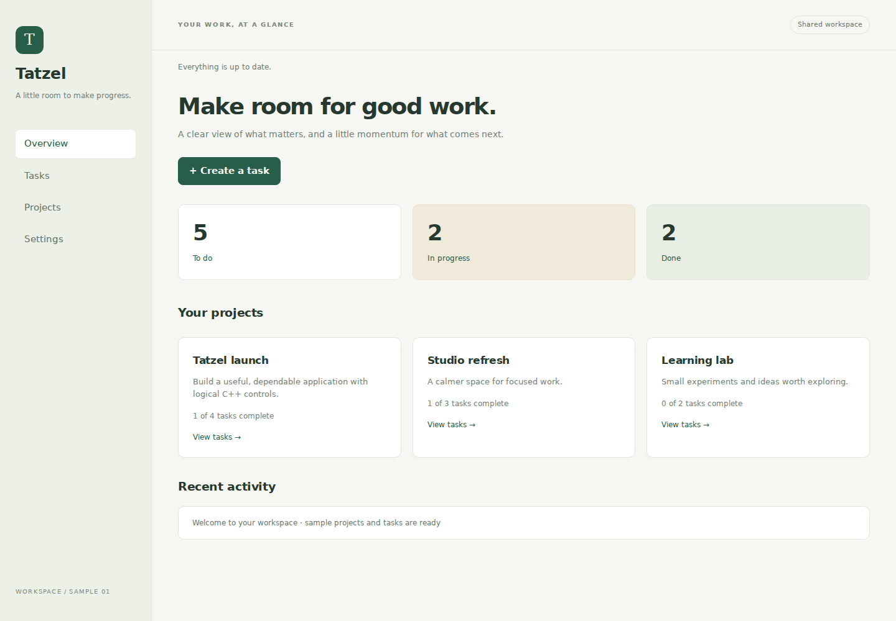

# Workspace sample application

`TatzelWorkspace` is a persistent project and task manager implemented with
Tatzel's logical C++ controls. Its browser code is the framework runtime: views,
forms, filtering, validation, and application actions are written in C++.



## Build and run

Install the normal [build dependencies](building.md), plus SQLite development
files (`libsqlite3-dev` on Ubuntu). The sample is enabled by default; set
`TATZEL_BUILD_WORKSPACE=OFF` when building only the framework and control gallery.

From the repository root:

```sh
cmake -S . -B build -G Ninja -DCMAKE_BUILD_TYPE=Debug -DCMAKE_CXX_COMPILER=clang++-18
cmake --build build --target TatzelWorkspace
./build/targets/workspace/TatzelWorkspace
```

Open `http://localhost:8080/`. Run the sample and `TatzelDevelopment` separately:
they both listen on port 8080. The existing development gallery remains available
through the `TatzelDevelopment` executable.

The sample creates `data/workspace.sqlite3` and its SQLite sidecar files. Those
files are ignored by Git. To select another database, set
`TATZEL_WORKSPACE_DB` to a writable filename whose parent directory already exists.
The initial dataset is inserted only when the database is first initialized.
Edits survive browser reloads and server restarts.

The sample uses `data/workspace.html` and local
`www/workspace/workspace.css`; no external stylesheet or font service is required.
App accepts optional configuration and template paths while retaining its original
defaults for existing applications.

## Complete workflows

- **Overview:** task counts by status, project completion counts, recent saved
  activity, and links into task lists.
- **Tasks:** search titles/descriptions, filter status or project, sort by title,
  creation order, or priority, and show archived work. Search replaces only result
  rows, preserving the search editor and focus.
- **Task details:** create or edit title, description, project, status, and
  priority; archive or restore; permanently delete through a confirmation dialog.
- **Projects:** create, rename, edit descriptions, archive, restore, and inspect
  related tasks. Restore an archived project before editing its tasks.
- **Settings:** save compact-list and completed-task defaults, or restore the
  original dataset through explicit confirmation.

The application has one shared workspace. All browser sessions see the same
records, activity, and display preferences; navigation, search, and filters are
local to each page. Authentication and workspace membership are outside this
sample's scope.

Hash routes support deep links, reload, native links, and browser Back/Forward.
For example, `/#/tasks` reopens the task list; task/project detail links include a
persistent numeric ID. Unknown locations and removed records show useful empty
states. Navigating away from an editor discards that view's unsaved draft.

Saving disables the current form and displays pending feedback. A failed save
reenables it and preserves entered values. The browser-owned connection banner
blocks further interaction after disconnect and provides a reload action.
Reload creates a fresh logical page; it does not restore unsaved drafts.

## Ownership and synchronization

`targets/workspace/private/Repository.*` owns SQLite access and domain records.
`Workspace.cpp` contains the worker service and per-browser view composition.
The sample is a separate executable, not part of the framework's domain model.

One application-owned worker executes database operations in queue order. Its
queue accepts up to 256 pending operations and reports rejection to the page.
Database work does not execute on the UI event loop. The worker drains accepted
operations before shutdown, and all UI completions use each page's Dispatcher.
Subscribers retain only weak page lifetimes and are pruned on registration or
publication. They do not keep disconnected pages alive.

Writes use bound parameters, transactions, and expected record versions. Updating
or deleting a stale task/project fails instead of overwriting newer data. Activity
entries commit with record changes. Repository errors are shown without clearing
the form and are also reported through Tatzel diagnostics.

Committed snapshots update connected list and overview views. An open editor is
preserved during external updates; saving an outdated version reports a conflict.
Copy any draft text you want to retain before reopening an item for its latest
version. A completed background save does not navigate a page that has since
switched to a different view.

Reset uses new monotonically increasing IDs, so an older open form cannot edit a
replacement seed record. Task titles/project names are limited to 160 UTF-8 bytes
and descriptions to 10,000 bytes. Search folds ASCII case and otherwise matches
UTF-8 bytes exactly; locale-aware collation is not implemented.

Snapshots contain the complete small workspace. Lists render matching rows
without pagination or virtualization. This keeps the sample readable and makes
its scale tradeoff explicit. It is not a benchmark for large datasets. Dispatcher
backpressure and connection closure can discard notifications; reload reads the
authoritative persisted state.

## Small framework additions

- `LogicalElement::SetAppearance` stores adapter-defined appearance names.
  The default adapter exposes them as `data-ui-appearance` on the base part,
  preserving built-in classes, event markers, and value synchronization.
- `PageBuilder::SetNavigationHandler` receives the initial hash after page
  construction, and subsequent browser hash changes.
- `PageBuilder::Navigate` invokes that handler and queues a same-page history
  update. Empty or hash-prefixed locations up to 2048 bytes are accepted. It
  cannot redirect the browser to another origin.
- App can select its configuration/template documents without changing existing
  default behavior.

Appearance names are interpreted by an adapter and its stylesheet; they do not
select arbitrary DOM parts. Navigation callbacks and all logical mutations remain
confined to the owning event loop.

## Verification

Enable `TATZEL_BUILD_TESTS` for the SQLite repository tests. They verify restart
persistence, literal SQL-like input, Unicode text, transaction rollback, archive
policies, stale updates/deletes, preferences, and fresh IDs after reset.

```sh
cmake -S . -B build -DTATZEL_BUILD_TESTS=ON
cmake --build build
ctest --test-dir build --output-on-failure
node tests/browser/workspace-smoke.mjs ./build/targets/workspace/TatzelWorkspace
npx playwright install chromium
node tests/browser/workspace-ui.mjs ./build/targets/workspace/TatzelWorkspace
```

Both application suites use isolated temporary databases. The protocol suite
restarts the real process and checks two-client synchronization. The Chromium
suite exercises actual controls, focus, history, modal confirmations, persisted
preferences, disconnect feedback, and narrow layouts. CI uploads desktop/mobile
screenshots as `tatzel-workspace-preview`.
